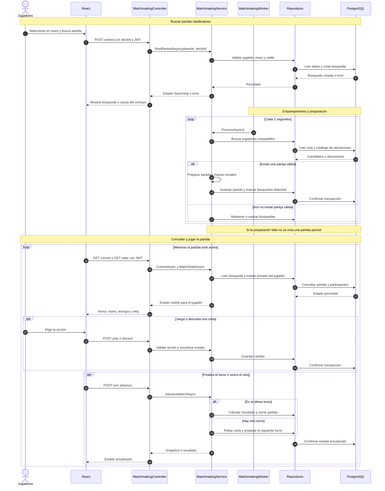

# Diagrama de secuencia: iniciar y jugar una partida

Este diagrama presenta el flujo principal. Los dos participantes se representan como un solo actor porque ambos usan los mismos endpoints y reciben un estado privado equivalente. Las validaciones internas de mazo, Elo, ubicaciones y cartas se resumen en el servicio para mantener el diagrama legible.

## Alternativa: partida contra bot

Si una búsqueda clasificatoria activa ofrece un bot, el jugador llama `POST /api/player/matchmaking/{searchId}/bot`. `AcceptBotAsync` valida la oferta y usa la misma preparación de partida. Si tiene éxito, crea una partida con `IsBot=true`; si no, devuelve el estado o error correspondiente. El bot recibe mano, robos y energía, pero actualmente no juega cartas automáticamente.

## Notas de lectura

- Los endpoints requieren el JWT de la plataforma. El servidor obtiene el jugador, Elo y saldo sin confiar en esos datos enviados por el cliente.
- El estado de la partida es autoritativo en PostgreSQL. La API oculta la semilla, el orden del mazo y la mano rival.
- La mano inicial es de tres cartas y el turno 1 realiza el primer robo.
- El mismo proceso de preparación se reutiliza en el contexto de torneo mediante `StartAsync`; el controlador no expone un endpoint HTTP público para iniciar búsquedas de torneo.
